**LAPORAN PRAKTIKUM BAB VI KELOMPOK 2**

**Disusun untuk Memenuhi Tugas Mata Kuliah:**

**Workshop DevOps**

**Dosen Pengampu :**

**Dr. Ferry Astika Saputra, ST, M.Sc**

**Oleh:**

**Ibram Maulana Akhsanul Qasasi NRP. 3126640014 Yusuf Rahmadhani Asy’ari NRP. 3126640042**

**Vernanda Mulia Hamonangan Manurung NRP. 3126640044**

**PROGRAM STUDI D4 LANJUT JENJANG TEKNIK INFORMATIKA POLITEKNIK ELEKTRONIKA NEGERI SURABAYA**

**2026**

**BAB VI**

**CENTRALIZED LOGGING DENGAN FLUENT BIT DAN POSTGRESQL**

- 1.  **Tahap Praktikum**
        1. **Persiapan Konfigurasi dan Pembuatan File Kotak Script 1 — File .env.example**

Dilakukan pembuatan file .env berdasarkan .env.example menggunakan perintah cp .env.example .env. File

.env.example berfungsi sebagai contoh konfigurasi variabel lingkungan yang dibutuhkan oleh PostgreSQL dan Fluent Bit, seperti nama database, pengguna database, dan password. Perintah chmod 600 .env digunakan untuk membatasi hak akses file agar hanya pemiliknya yang dapat membaca dan mengubah file tersebut. Hal ini penting karena file .env menyimpan informasi sensitif yang digunakan oleh layanan. Pemeriksaan menggunakan stat -c '%a %n' .env menunjukkan izin 600, yang berarti akses terhadap file telah dibatasi. Dalam penerapan sebenarnya, password harus menggunakan nilai yang kuat dan tidak boleh membagikan file .env ke repositori publik.

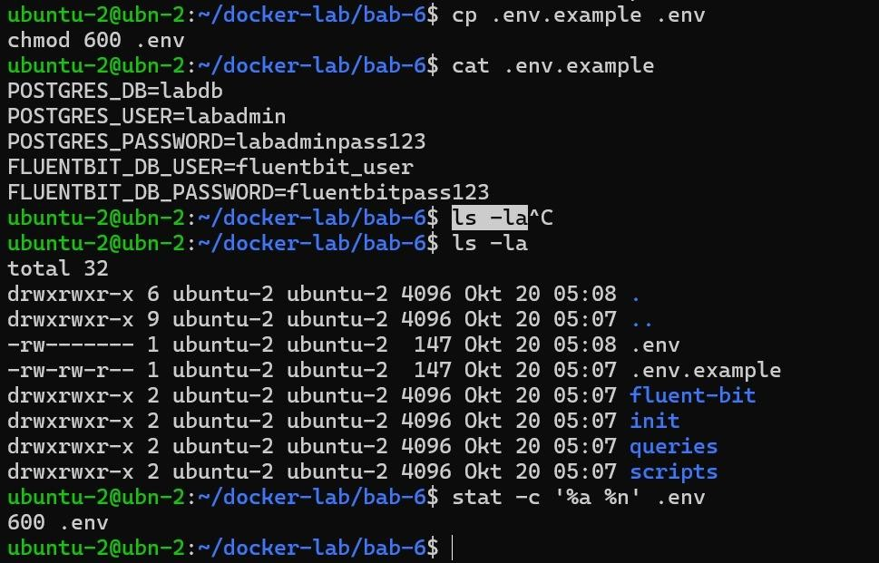

# Kotak Script 2 — File .gitignore

Diperlihatkan isi file .gitignore yang digunakan untuk menentukan file atau direktori yang tidak perlu dimasukkan ke dalam repositori Git. Konfigurasi .env mencegah file yang berisi konfigurasi sensitif ikut dilacak oleh Git, sedangkan \*.log digunakan untuk mengabaikan file yang memiliki ekstensi log dan reports/ untuk mengabaikan direktori laporan. Pengaturan ini membantu mengurangi risiko kebocoran informasi sensitif dan menjaga repositori tetap berisi berkas yang diperlukan untuk pengembangan. Namun, .gitignore tidak menghapus file yang sebelumnya sudah terlanjur dilacak oleh Git, sehingga file sensitif yang sudah terunggah perlu ditangani secara terpisah.

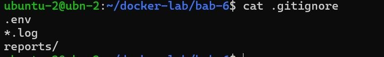

# Kotak Script 3 — File compose.yaml

Dibuat konfigurasi Docker Compose untuk menjalankan PostgreSQL, Fluent Bit, dan tiga container pembangkit log, yaitu generator-auth, generator-api, dan generator-worker. PostgreSQL menggunakan image postgres:16-alpine, sedangkan Fluent Bit menggunakan image fluent/fluent-bit:4.2.8. Variabel lingkungan digunakan agar konfigurasi database dan password dapat diambil dari file .env tanpa menuliskannya langsung sebagai nilai tetap di dalam konfigurasi Compose.

Bagian volumes pada layanan PostgreSQL menggunakan named volume pg-data untuk menyimpan data database agar tetap tersedia meskipun container dibuat ulang. Direktori ./init dipasang ke /docker-entrypoint-initdb.d dengan opsi ro, yang berarti berkas inisialisasi hanya dapat dibaca dari dalam container. Opsi ini membantu mencegah perubahan terhadap berkas inisialisasi melalui container. Konfigurasi healthcheck dengan perintah pg\_isready digunakan untuk memeriksa apakah PostgreSQL sudah siap menerima koneksi. Sementara

itu, depends\_on dengan kondisi service\_healthy membuat Fluent Bit menunggu sampai layanan PostgreSQL dinyatakan sehat sebelum dijalankan.

Ketiga layanan generator menggunakan image Alpine dan perintah shell untuk menghasilkan log dengan isi yang berbeda. Generator autentikasi menghasilkan event login, generator API menghasilkan event pengujian latensi, dan generator worker menghasilkan event percobaan ulang. Setiap generator mengirimkan log melalui Docker logging driver fluentd menuju alamat Fluent Bit pada port 24224. Opsi fluentd-async: "true" memungkinkan pengiriman log secara asinkron sehingga proses aplikasi tidak harus selalu menunggu penerima log siap pada saat yang sama. Tag docker.{{.Name}} digunakan untuk membedakan sumber log berdasarkan nama container. Selain itu, port monitoring 2020 dan port penerimaan log 24224 hanya dipublikasikan pada alamat 127.0.0.1, sehingga tidak langsung dibuka ke seluruh antarmuka jaringan host.

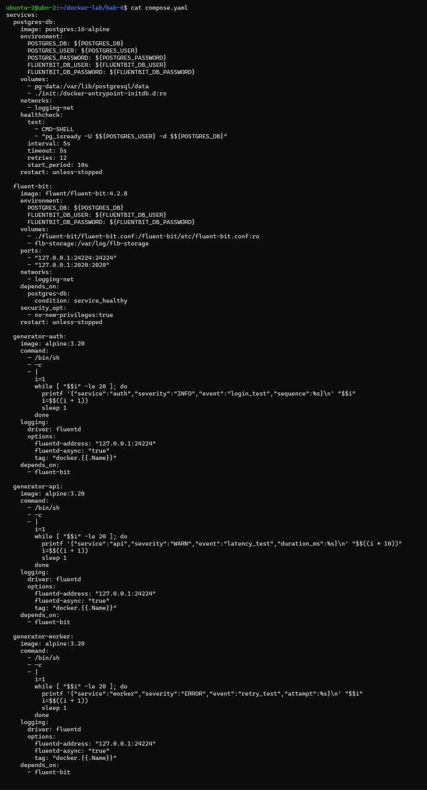

# Pembuatan Database dan Konfigurasi Pengumpulan Log Kotak Script 4 — File init/01-init-logging.sh

Script inisialisasi PostgreSQL yang bertugas menyiapkan akun pengguna, schema, tabel, indeks, view, dan hak

akses yang dibutuhkan Fluent Bit. Baris set -Eeuo pipefail membuat script lebih ketat dalam menangani kesalahan. Opsi -e membantu menghentikan script ketika perintah gagal, -u membuat penggunaan variabel yang belum ditentukan dianggap sebagai kesalahan, sedangkan pipefail membuat kegagalan perintah dalam pipeline tidak mudah terabaikan. Pemeriksaan variabel seperti POSTGRES\_USER, POSTGRES\_DB, FLUENTBIT\_DB\_USER, dan FLUENTBIT\_DB\_PASSWORD memastikan nilai yang dibutuhkan tersedia sebelum proses inisialisasi dilakukan.

Perintah psql dijalankan dengan ON\_ERROR\_STOP=1 agar kesalahan SQL dapat menghentikan proses inisialisasi. Script menggunakan CREATE ROLE untuk membuat pengguna khusus Fluent Bit apabila pengguna tersebut belum tersedia. Penggunaan format() bersama %I untuk identifier SQL dan %L untuk literal SQL membantu menghasilkan perintah SQL dengan penanganan nilai yang sesuai. Perintah \\gexec pada psql menjalankan perintah SQL yang dihasilkan oleh query sebelumnya. Dengan cara ini, pembuatan role dapat dilakukan secara bersyarat sehingga script lebih aman ketika dijalankan kembali.

Selanjutnya, CREATE SCHEMA IF NOT EXISTS logs membuat schema logs jika belum tersedia, sedangkan CREATE TABLE IF NOT EXISTS logs.fluentbit menyiapkan tabel untuk menyimpan tag, waktu penerimaan, dan data log dalam tipe JSONB. Indeks pada kolom waktu dan tag membantu mempercepat pencarian berdasarkan waktu maupun sumber log. Indeks GIN pada kolom data berguna untuk mendukung pencarian terhadap isi JSON. Script juga membuat view logs.recent\_logs yang menampilkan log terbaru beserta nama container, sumber log, dan cuplikan pesan. Terakhir, perintah GRANT memberikan hak akses yang diperlukan kepada pengguna Fluent Bit, yaitu penggunaan schema serta hak membaca dan memasukkan data ke tabel. Pembatasan hak akses ini lebih baik daripada menggunakan akun administrator database untuk proses pengiriman log sehari-hari.

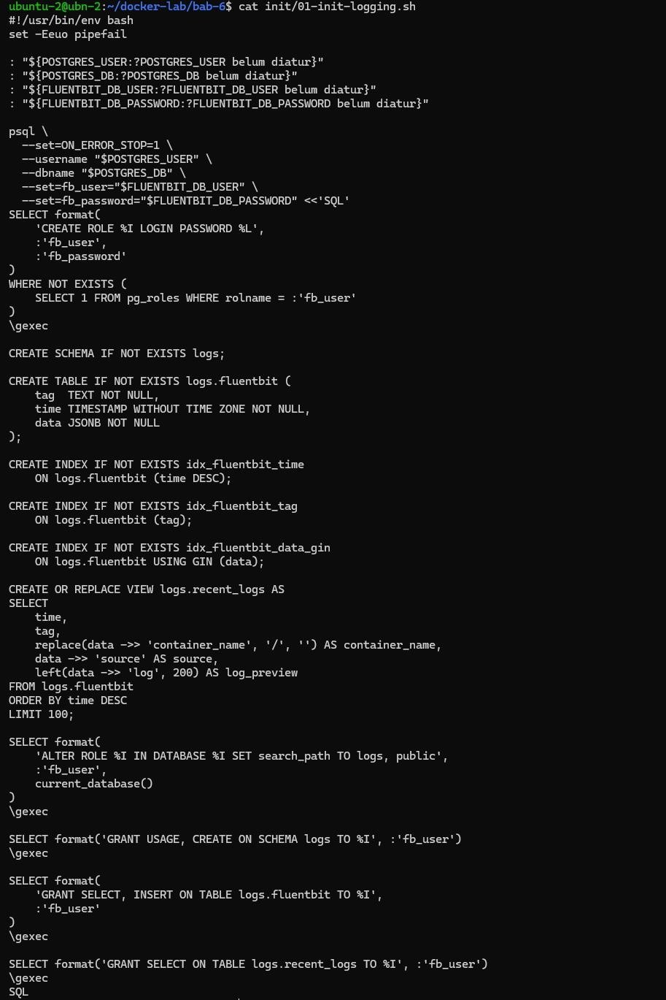

# Kotak Script 5 — File fluent-bit/fluent-bit.conf

Dilakukan konfigurasi Fluent Bit sebagai penerima dan penerus log. Bagian \[SERVICE\] mengatur perilaku umum Fluent Bit, termasuk tingkat pencatatan pesan internal melalui Log\_Level info, penggunaan penyimpanan buffer melalui storage.path, dan layanan HTTP untuk monitoring. Pengaturan storage.sync normal serta storage.checksum on membantu mengatur penyimpanan buffer dan pemeriksaan integritas data buffer. Batas storage.backlog.mem\_limit 10M mengatur batas memori untuk backlog yang sedang diproses dari penyimpanan. Pengaturan ini penting agar pengelolaan log tidak menggunakan memori secara berlebihan.

Bagian \[INPUT\] menggunakan plugin forward untuk menerima log dari Docker logging driver melalui port 24224. Pengaturan Mem\_Buf\_Limit 10M membatasi buffer dalam memori, sedangkan storage.type filesystem memungkinkan buffer menggunakan penyimpanan file ketika diperlukan. Mekanisme ini membantu menangani kondisi ketika tujuan pengiriman log mengalami gangguan sementara. Bagian \[OUTPUT\] pertama menggunakan plugin pgsql untuk mengirimkan log ke PostgreSQL dengan mengambil nama database dan kredensial dari variabel lingkungan. Pengaturan Match \* berarti output tersebut menerima semua tag yang cocok. Sementara itu, output kedua menggunakan plugin stdout dengan format json\_lines agar data log juga dapat ditampilkan dalam keluaran standar untuk membantu pemeriksaan dan debugging. Dengan konfigurasi ini, log tidak hanya diterima, tetapi juga diarahkan ke database untuk disimpan dan dianalisis.

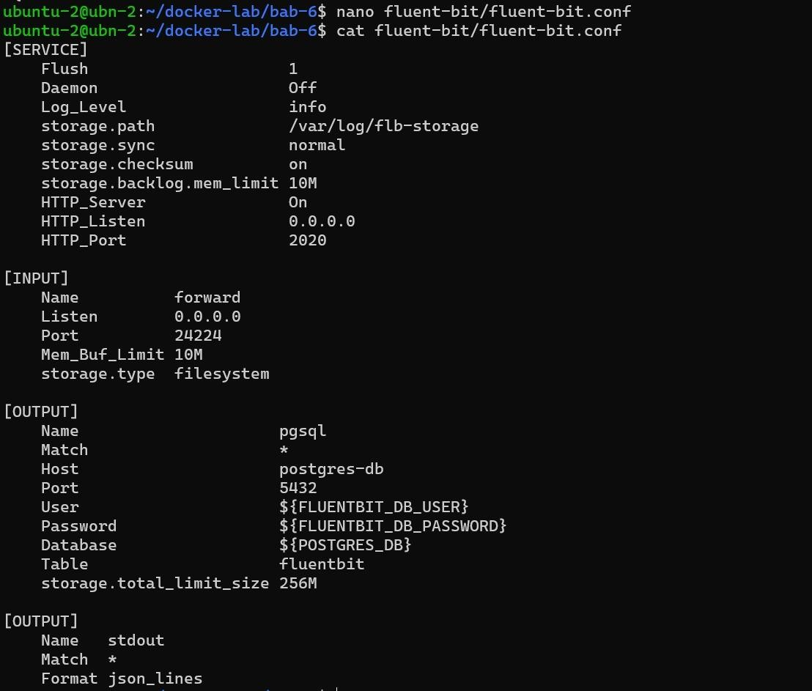

# Pembuatan Query dan Script Pengujian Kotak Script 6 — File queries/analysis.sql

Dibuat kumpulan query SQL untuk menganalisis data log yang telah disimpan dalam tabel logs.fluentbit. Perintah \\pset pager off digunakan untuk menonaktifkan tampilan pager pada psql, sedangkan \\timing on menampilkan waktu eksekusi query. Query pertama menghitung jumlah seluruh event menggunakan COUNT(\*) serta mengambil waktu event paling awal dan paling akhir melalui MIN(time) dan MAX(time). Informasi tersebut membantu mengetahui jumlah data yang sudah diterima dan rentang waktu pencatatannya.

Query kedua menggunakan GROUP BY tag untuk menghitung jumlah log dari setiap sumber. Hasilnya dapat digunakan untuk memastikan bahwa log dari generator autentikasi, API, dan worker masuk ke database. Query ketiga mengambil metadata dari kolom JSONB menggunakan operator ->>, yang digunakan untuk mengambil nilai sebuah properti JSON sebagai teks. Fungsi replace() menghapus karakter garis miring dari nama container, sedangkan left() membatasi panjang cuplikan pesan agar hasil query lebih mudah dibaca. Query keempat mencari pesan yang memuat informasi tingkat kesalahan ERROR menggunakan ILIKE, yaitu pencarian teks tanpa membedakan huruf besar dan kecil. Query kelima menggunakan date\_trunc('minute', time) untuk mengelompokkan event berdasarkan menit sehingga laju penerimaan log dapat diamati. Terdapat pula contoh query retensi yang dinonaktifkan dengan tanda komentar. Query penghapusan tersebut tidak dijalankan secara otomatis, sehingga penghapusan data lama perlu ditinjau terlebih dahulu sebelum diterapkan.

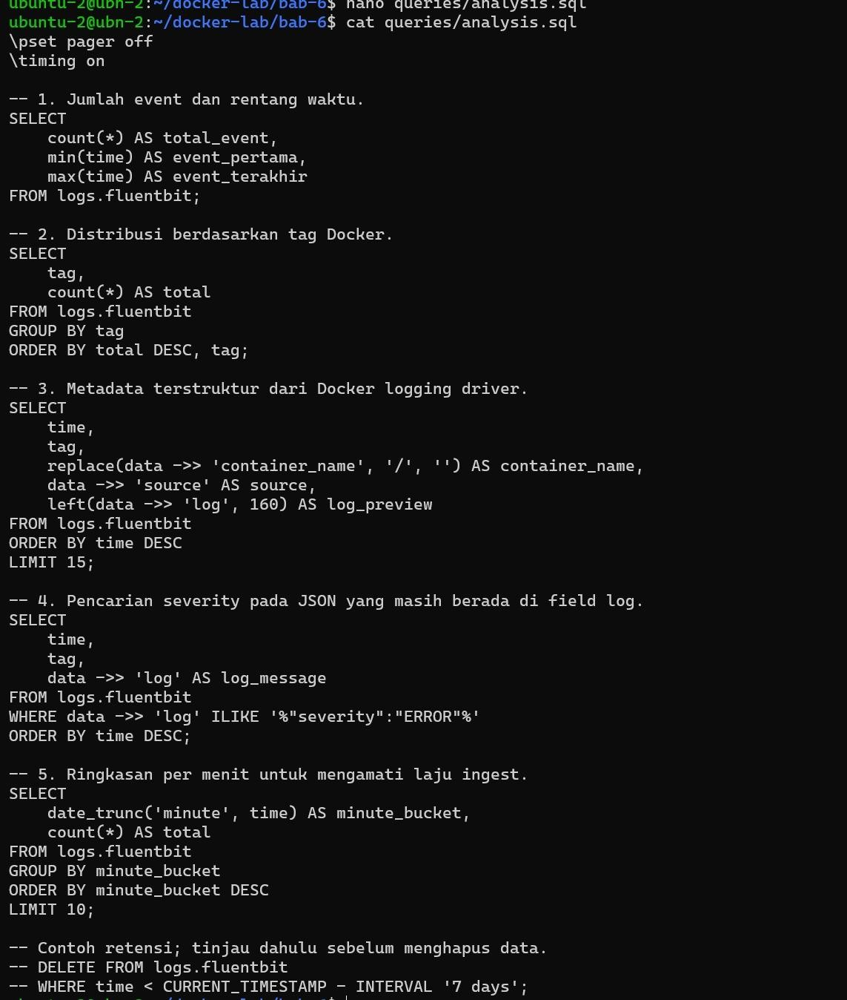

# Kotak Script 7 — File scripts/generate-logs.sh

Dibuat script untuk menjalankan layanan yang dibutuhkan dan menghasilkan log pengujian secara otomatis. Baris set -Eeuo pipefail digunakan untuk memperketat penanganan kesalahan, sedangkan cd "$(dirname "$0")/.." memastikan script berpindah ke direktori utama proyek berdasarkan lokasi file script. Cara ini membuat script tidak bergantung pada direktori kerja saat perintah dijalankan. Pemeriksaan if \[\[ ! -f .env \]\] memastikan file konfigurasi tersedia sebelum layanan dijalankan. Jika file tidak ditemukan, script menampilkan pesan kegagalan dan menghentikan proses menggunakan exit 1.

Selanjutnya, perintah docker compose up -d postgres-db fluent-bit menjalankan PostgreSQL dan Fluent Bit di latar belakang. Script kemudian melakukan pemeriksaan berulang terhadap endpoint kesehatan Fluent Bit melalui curl -fsS ke alamat [http://127.0.0.1:2020/api/v1/health](http://127.0.0.1:2020/api/v1/health). Opsi -f membantu mendeteksi respons HTTP yang menunjukkan kegagalan, -s menonaktifkan keluaran progres, dan -S tetap menampilkan pesan kesalahan. Jika endpoint belum siap setelah jumlah percobaan yang ditentukan, script menampilkan pesan gagal dan berhenti. Setelah Fluent Bit siap, ketiga generator dijalankan ulang menggunakan --force-recreate agar proses pengujian dimulai dari container baru. Script ini mempermudah pelaksanaan praktikum karena pemeriksaan kesiapan layanan dilakukan sebelum generator mulai mengirimkan log.

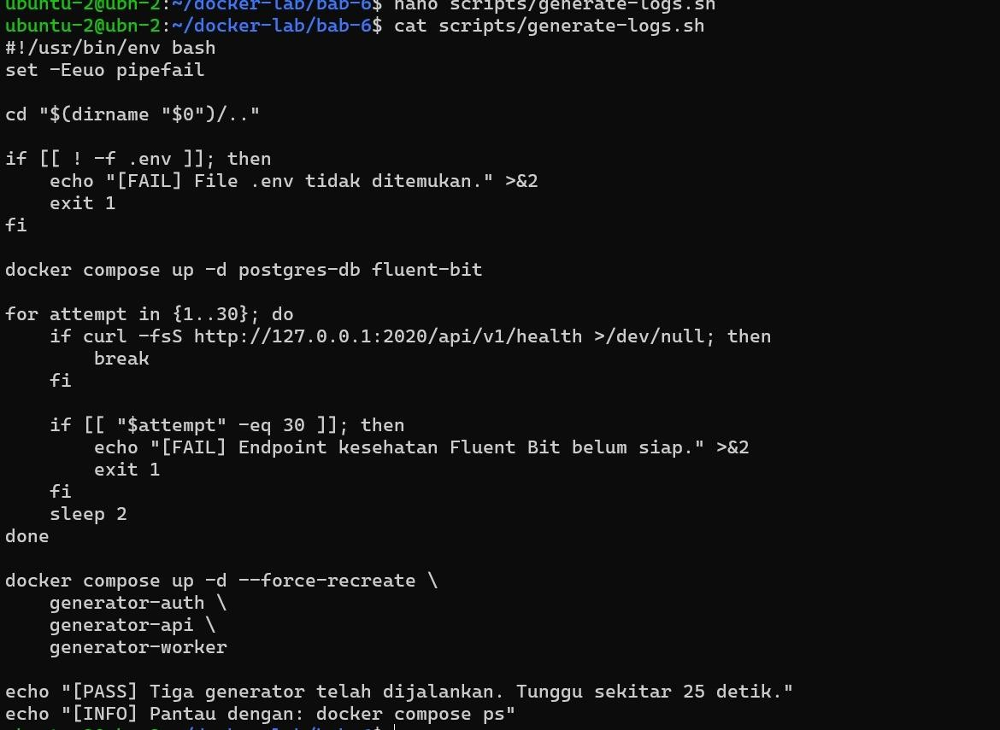

# Kotak Script 8 — File scripts/test-buffering.sh

Dibuat script untuk menguji apakah Fluent Bit dapat mempertahankan log ketika PostgreSQL berhenti sementara dan melanjutkan pengiriman setelah database kembali aktif. Script terlebih dahulu memeriksa keberadaan .env, kemudian menggunakan set -a dan source .env agar variabel dari file tersebut diekspor ke lingkungan shell. Fungsi count\_rows() menjalankan query SELECT count(\*) FROM logs.fluentbit melalui docker compose exec -T postgres-db psql. Opsi -T menonaktifkan alokasi pseudo-terminal sehingga keluaran perintah lebih sesuai untuk diproses oleh script.

Jumlah data awal disimpan dalam variabel before. Setelah itu, PostgreSQL dihentikan sementara menggunakan docker compose stop postgres-db, sedangkan ketiga generator dijalankan kembali. Selama database berhenti, Fluent Bit diharapkan menampung log yang masuk menggunakan mekanisme buffering. Setelah waktu pengujian selesai, PostgreSQL dijalankan kembali dan script memeriksa kesiapan database menggunakan pg\_isready. Pemeriksaan berulang dilakukan agar script tidak langsung menganggap database gagal hanya karena proses pemulihan membutuhkan waktu.

Terakhir, script menghitung jumlah data kembali dan membandingkannya dengan jumlah awal. Jika jumlah data meningkat, script menampilkan \[PASS\] beserta jumlah kenaikan record dan mengakhiri proses dengan kode keluar 0. Jika tidak ada penambahan record setelah batas percobaan, script menampilkan \[FAIL\] dan petunjuk untuk memeriksa log Fluent Bit. Mekanisme ini penting karena pengujian tidak hanya memeriksa apakah layanan berjalan, tetapi juga apakah log yang dihasilkan selama gangguan dapat diteruskan setelah database pulih.

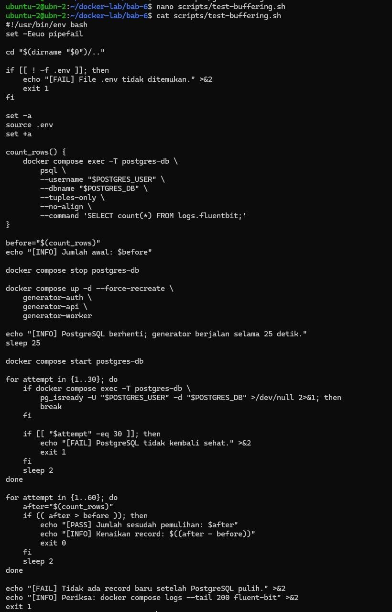

# Pelaksanaan dan Pemeriksaan Hasil Praktikum

**Kotak Perintah B — Memberi Izin Eksekusi dan Memvalidasi Berkas**

Dilakukan persiapan script dan validasi konfigurasi sebelum pipeline dijalankan. Script shell perlu memiliki izin eksekusi agar dapat dipanggil sebagai program, misalnya melalui chmod +x scripts/generate-logs.sh dan chmod +x scripts/test-buffering.sh. Setelah itu, konfigurasi Docker Compose diperiksa menggunakan docker compose config --quiet. Perintah tersebut memvalidasi struktur dan sintaks konfigurasi Compose tanpa menampilkan seluruh konfigurasi yang sudah diproses. Jika perintah selesai tanpa kesalahan, konfigurasi dapat dilanjutkan ke tahap menjalankan layanan. Validasi ini penting karena kesalahan penulisan YAML, nama layanan, atau referensi variabel dapat menyebabkan layanan gagal dibuat.

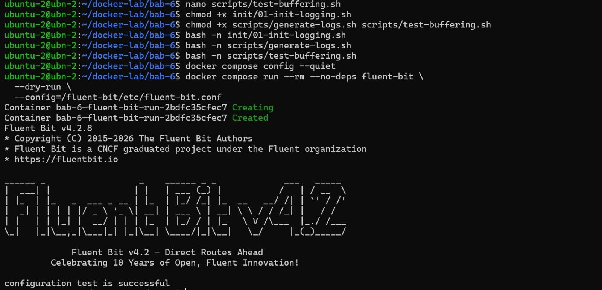

# Kotak Perintah C — Menjalankan Pipeline dan Menghasilkan Log

Pipeline dijalankan dengan memanggil script generate-logs.sh. Script akan menjalankan PostgreSQL dan Fluent Bit terlebih dahulu, memeriksa endpoint kesehatan, lalu memulai ketiga generator log. Setiap generator menghasilkan event dengan jenis yang berbeda, sehingga data yang masuk ke sistem dapat dibedakan berdasarkan tag dan isi pesannya. Pesan \[PASS\] menunjukkan bahwa script telah melewati pemeriksaan kesiapan Fluent Bit dan menjalankan generator. Setelah proses tersebut, log dibiarkan berjalan selama waktu yang ditentukan agar cukup banyak record terkumpul untuk dianalisis. Tahap ini menjadi bukti bahwa proses pengumpulan log dilakukan secara otomatis, bukan dengan memasukkan data secara manual ke database.

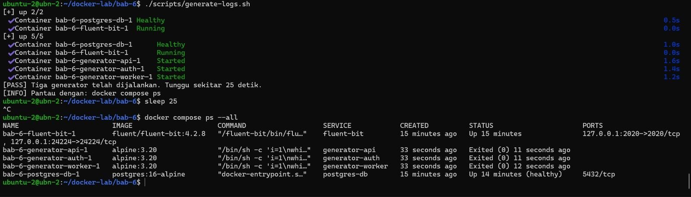

# Kotak Perintah D — Memeriksa Monitoring Fluent Bit

Dilakukan pemeriksaan terhadap layanan Fluent Bit melalui endpoint monitoring HTTP pada port 2020. Endpoint kesehatan digunakan untuk memastikan bahwa layanan merespons permintaan pemeriksaan. Pemeriksaan ini membantu membedakan kondisi ketika container sekadar berstatus berjalan dengan kondisi ketika layanan di dalam container sudah siap merespons. Port monitoring dipublikasikan pada alamat loopback 127.0.0.1, sehingga pemeriksaan dilakukan dari host lokal dan tidak langsung membuka endpoint tersebut ke seluruh jaringan. Hasil pemeriksaan yang berhasil menunjukkan bahwa endpoint dapat diakses, tetapi tidak dengan sendirinya membuktikan bahwa seluruh log telah tersimpan di PostgreSQL. Oleh karena itu, hasil monitoring tetap perlu dilengkapi dengan pemeriksaan data pada database.

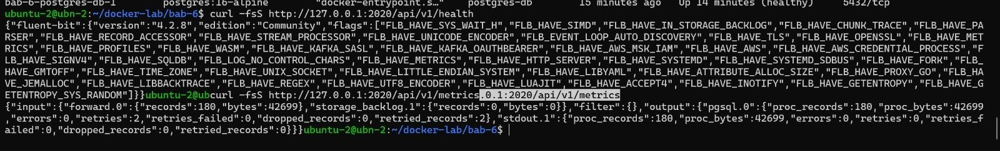

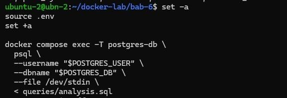

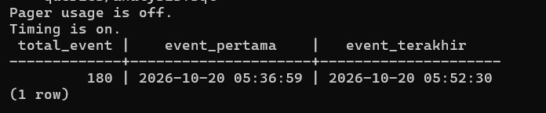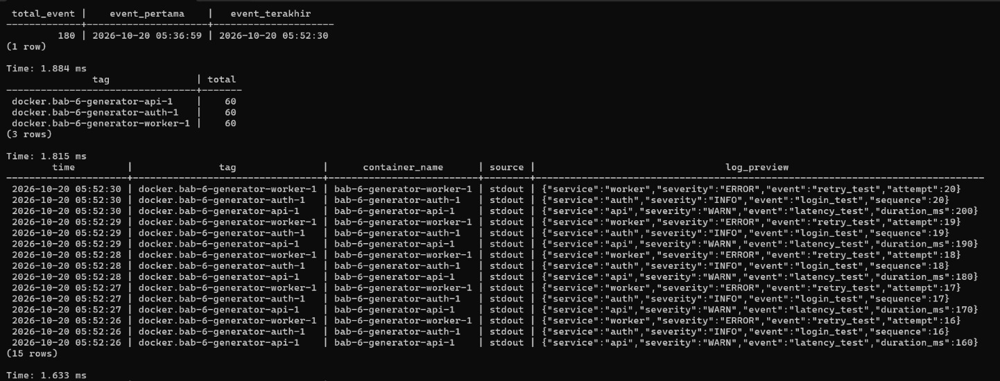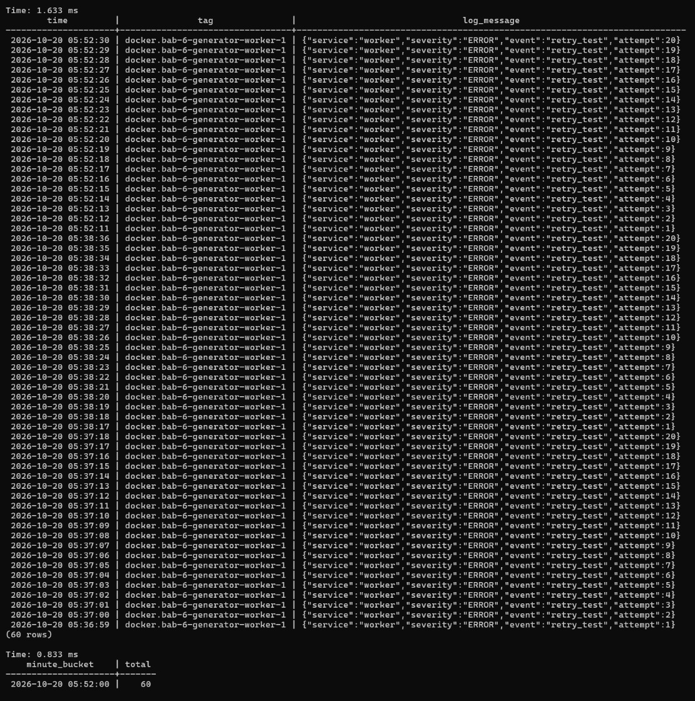

# Kotak Perintah E — Memverifikasi Record PostgreSQL

Dilakukan pemeriksaan terhadap record yang berhasil disimpan di PostgreSQL. Query untuk menghitung jumlah record digunakan untuk mengetahui banyaknya log yang masuk, sedangkan query berdasarkan tag digunakan untuk melihat distribusi log dari masing-masing generator. Jika hasilnya menampilkan tag dari generator autentikasi, API, dan worker, berarti ketiga sumber telah mengirimkan log yang dapat ditemukan di database. Pemeriksaan juga dilakukan terhadap metadata seperti container\_name, source, dan log yang disimpan dalam kolom JSONB. Metadata tersebut penting karena membantu mengidentifikasi asal log dan membaca isi pesan tanpa harus mengandalkan nama container saja.

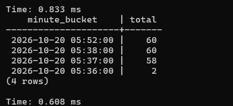

# Verifikasi tipe data dapat dilakukan dengan:

Dilakukan pemeriksaan terhadap struktur penyimpanan data log di PostgreSQL. Kolom data menggunakan tipe JSONB, yaitu tipe data PostgreSQL untuk menyimpan dokumen JSON dalam bentuk biner yang mendukung pemrosesan dan pengindeksan. Tipe ini memungkinkan informasi seperti nama container, sumber log, dan pesan diambil menggunakan operator JSON, misalnya data ->> 'source'. Pemeriksaan tipe data menggunakan pg\_typeof(data) membantu memastikan bahwa kolom tersebut benar-benar bertipe jsonb, bukan sekadar teks biasa. Verifikasi ini penting karena query analisis pada praktikum bergantung pada kemampuan PostgreSQL mengakses properti JSON secara langsung.

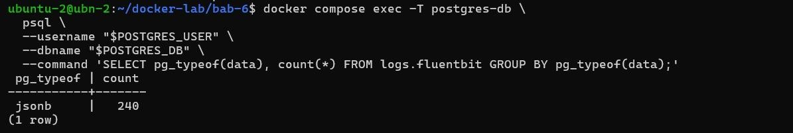

# Verifikasi PASS/FAIL Verifikasi 1 — Validasi Compose

Verifikasi pertama dilakukan menggunakan perintah docker compose config --quiet. Perintah ini digunakan untuk memeriksa apakah konfigurasi Docker Compose dapat diproses tanpa kesalahan. Jika perintah selesai dengan kode keluar 0, konfigurasi dinyatakan valid dan dapat dilanjutkan ke tahap menjalankan layanan. Pemeriksaan ini penting karena kesalahan sintaks atau konfigurasi dapat menyebabkan layanan tidak berhasil dibuat.

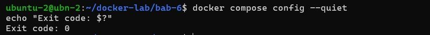

# Verifikasi 2 — Kesehatan Backend

Verifikasi kedua dilakukan dengan menjalankan docker compose ps untuk memeriksa status layanan PostgreSQL. Status healthy menunjukkan bahwa pemeriksaan kesehatan yang dikonfigurasi untuk PostgreSQL berhasil. Hal ini menjadi indikator bahwa backend database siap digunakan berdasarkan healthcheck yang ditetapkan. Pemeriksaan ini lebih informatif daripada hanya melihat apakah container berstatus berjalan, meskipun query database tetap diperlukan untuk membuktikan bahwa data dapat dibaca dan ditulis.

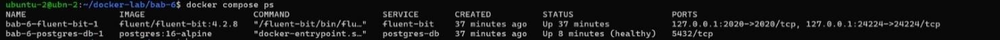

# Verifikasi 3 — Kesehatan Collector

Verifikasi ketiga dilakukan dengan memeriksa endpoint kesehatan Fluent Bit melalui /api/v1/health. Respons HTTP dalam rentang 2xx menunjukkan bahwa permintaan berhasil diproses. Pemeriksaan ini digunakan untuk memastikan bahwa endpoint monitoring dapat diakses dan memberikan respons sukses. Namun, hasil tersebut tidak secara langsung membuktikan bahwa seluruh log telah masuk ke PostgreSQL, sehingga perlu dikombinasikan dengan pemeriksaan record database.

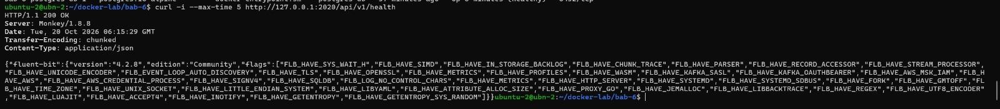

# Verifikasi 4 — Tiga Sumber Log

Verifikasi keempat dilakukan menggunakan query GROUP BY tag untuk mengelompokkan record berdasarkan tag sumber log. Hasil yang menampilkan sedikitnya tiga tag berbeda menjadi indikator bahwa log dari tiga generator, yaitu autentikasi, API, dan worker, telah diterima. Pemeriksaan ini penting karena keberhasilan pipeline tidak hanya ditentukan oleh adanya data, tetapi juga oleh kemampuan sistem menerima log dari beberapa sumber yang berbeda.

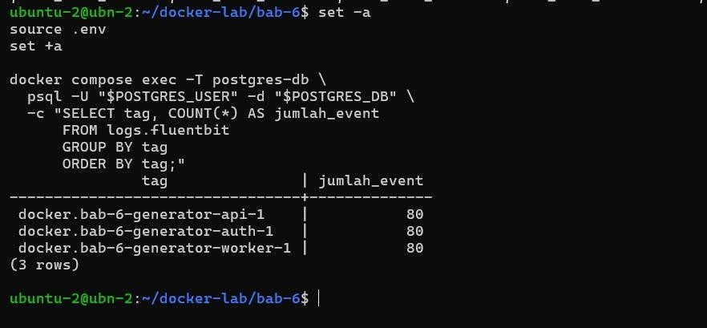

# Verifikasi 5 — Struktur Record

Verifikasi kelima dilakukan untuk memastikan bahwa record log memiliki field penting, yaitu container\_name, source, dan log. Field container\_name digunakan untuk mengidentifikasi nama container pengirim, source menunjukkan asal log, dan log berisi pesan yang dicatat. Kelengkapan field tersebut membantu proses penelusuran sumber masalah dan analisis log. Dengan demikian, data yang tersimpan tidak hanya berupa kumpulan pesan, tetapi juga memiliki informasi pendukung yang berguna.

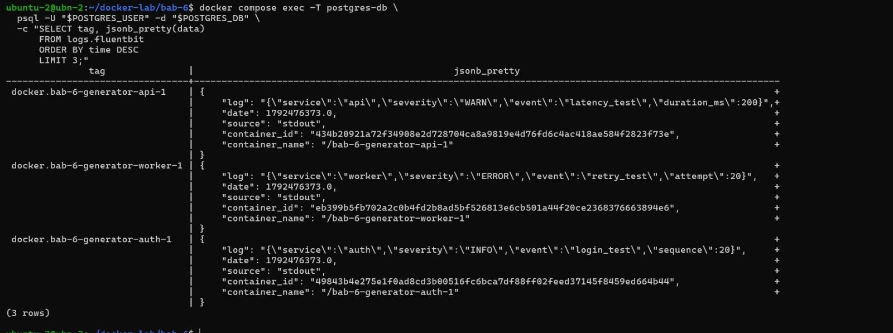

# Verifikasi 6 — Penyimpanan JSONB

Verifikasi keenam dilakukan menggunakan fungsi pg\_typeof(data) untuk memeriksa tipe data kolom data pada tabel log. Hasil jsonb menunjukkan bahwa data disimpan menggunakan tipe JSONB sesuai konfigurasi. Tipe data ini memungkinkan informasi dalam dokumen log diakses melalui query SQL dan mendukung pengindeksan terhadap isi JSON. Pemeriksaan ini penting untuk memastikan bahwa struktur penyimpanan sesuai dengan rancangan analisis yang digunakan pada praktikum.

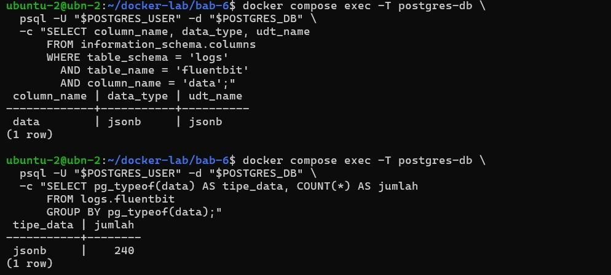

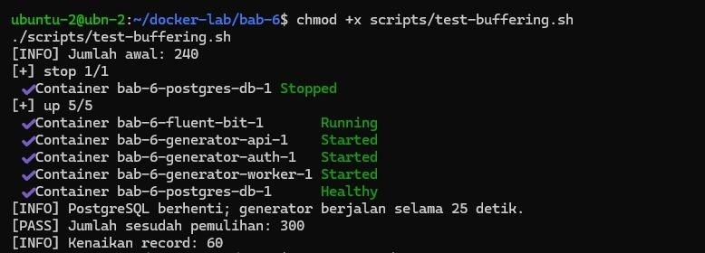

# Verifikasi 7 — Pemulihan Output

Verifikasi ketujuh dilakukan menggunakan test-buffering.sh untuk memeriksa apakah jumlah record bertambah setelah PostgreSQL kembali aktif. Script membandingkan jumlah record sebelum dan sesudah pengujian. Jika jumlah record meningkat, script menampilkan \[PASS\] beserta jumlah penambahan record. Hasil ini menunjukkan bahwa terdapat log baru yang berhasil tersimpan setelah database pulih dari gangguan sementara. Pengujian tersebut mendukung penilaian bahwa pipeline dapat melanjutkan pengiriman log setelah database kembali tersedia. Namun, untuk memastikan tidak ada log yang hilang, diperlukan pemeriksaan tambahan terhadap jumlah log yang dihasilkan dan jumlah log yang berhasil diterima.

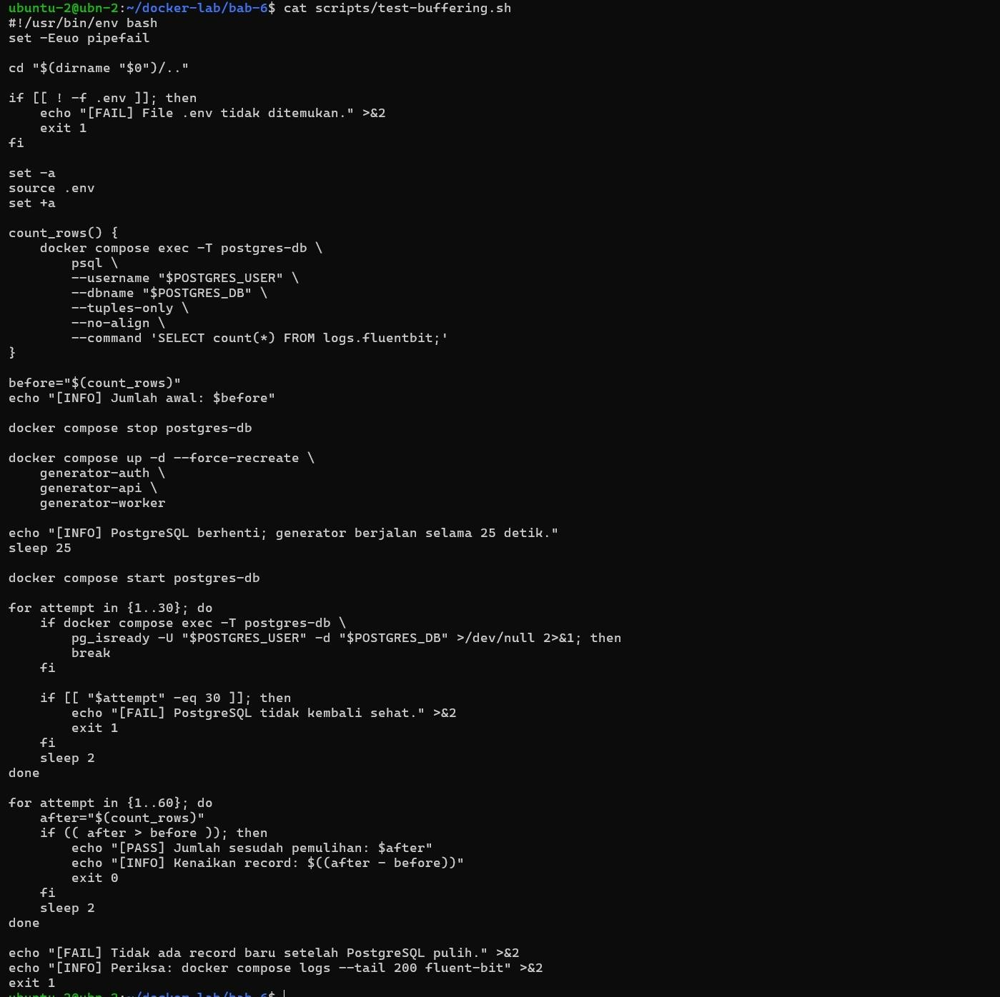

# Verifikasi 8 — Pembatasan Jaringan PostgreSQL

Verifikasi kedelapan dilakukan untuk memastikan bahwa PostgreSQL tidak memiliki published port ke host. PostgreSQL tetap dapat diakses oleh Fluent Bit melalui jaringan internal Docker Compose menggunakan nama layanan dan port database 5432. Tidak memublikasikan port database membantu mengurangi risiko akses langsung dari luar lingkungan container. Pada konfigurasi ini, port monitoring dan penerimaan log Fluent Bit dibatasi ke alamat 127.0.0.1, sehingga tidak langsung dibuka ke seluruh jaringan. Pembatasan tersebut merupakan langkah keamanan untuk mengurangi permukaan serangan dan memastikan layanan hanya membuka akses yang dibutuhkan.

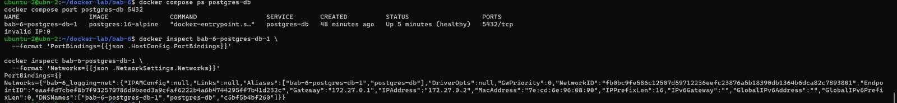

# Penambahan Grafana diluar Cheatsheet BAB 6 Konfigurasi Kredensial dan Penyiapan Hak Akses Basis Data

Pada tahap awal, konfigurasi variabel lingkungan disimpan di dalam berkas .env untuk memusatkan parameter sensitif seperti nama basis data (POSTGRES\_DB=labdb), akun administrator PostgreSQL, serta kredensial untuk Fluent Bit dan Grafana (GRAFANA\_DB\_USER=grafana\_reader, GRAFANA\_DB\_PASSWORD, dan GRAFANA\_ADMIN\_PASSWORD). Selanjutnya, pembuatan peran (_role_) baru bernama grafana\_reader dilakukan langsung dari container PostgreSQL menggunakan perintah docker compose exec. Akun ini dikonfigurasi berdasarkan prinsip _least privilege_, di mana hak akses yang diberikan hanya sebatas CONNECT ke database labdb, USAGE pada skema logs, serta hak SELECT untuk seluruh tabel dalam skema

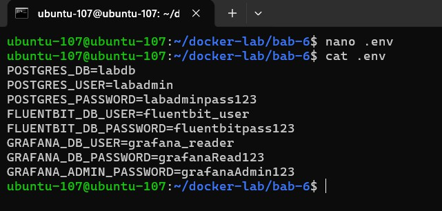

# Pengaturan Service pada Docker Compose dan Penyebaran Stack

Definisi infrastruktur disusun di dalam berkas compose.yaml yang mencakup service postgres-db berbasis _image_ postgres:16-alpine lengkap dengan pengujian kesehatan (_healthcheck_) pg\_isready. Service fluent-bit dikonfigurasi untuk mengekspos port 24224 untuk penerimaan log Forward dan port 2020 untuk pemantauan HTTP. Penambahan service grafana menggunakan _image_ grafana/grafana:latest dilakukan dengan mengaitkan kata sandi admin dari file lingkungan, mempublikasikan port 3000, serta menetapkan dependensi agar Grafana baru berjalan setelah postgres-db dalam kondisi sehat. Setelah berkas dipastikan valid menggunakan docker compose config quiet, seluruh container dieksekusi dengan docker compose up -d. Hasil verifikasi melalui docker compose ps mengonfirmasi bahwa seluruh service utama (fluent-bit, grafana, dan postgres-db) telah berstatus aktif dan sehat.

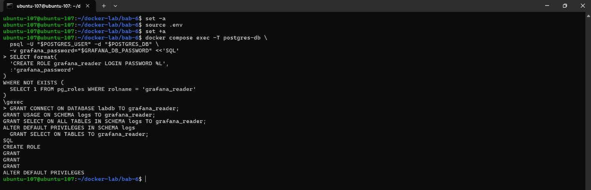

# Pengalihan Port SSH dan Akses Antarmuka Grafana

Proses inisialisasi awal sistem dibuktikan dengan berjalannya skrip migrasi basis data secara otomatis untuk membuat tabel pendukung dan indeks. Untuk mengakses antarmuka Grafana dari mesin lokal secara aman, dijalankan perintah pengalihan port SSH (_Local Port Forwarding_) melalui perintah ssh -L 3000:127.0.0.1:3000 [ubuntu-2@10.252.108.103](mailto:ubuntu-2@10.252.108.103). Setelah pengalihan port aktif, antarmuka web Grafana diakses melalui URL [http://localhost:3000](http://localhost:3000/) yang menampilkan halaman _login_ resmi Grafana v12.2.4. Pengguna kemudian melakukan autentikasi hingga berhasil masuk ke halaman utama _Welcome to Grafana_.

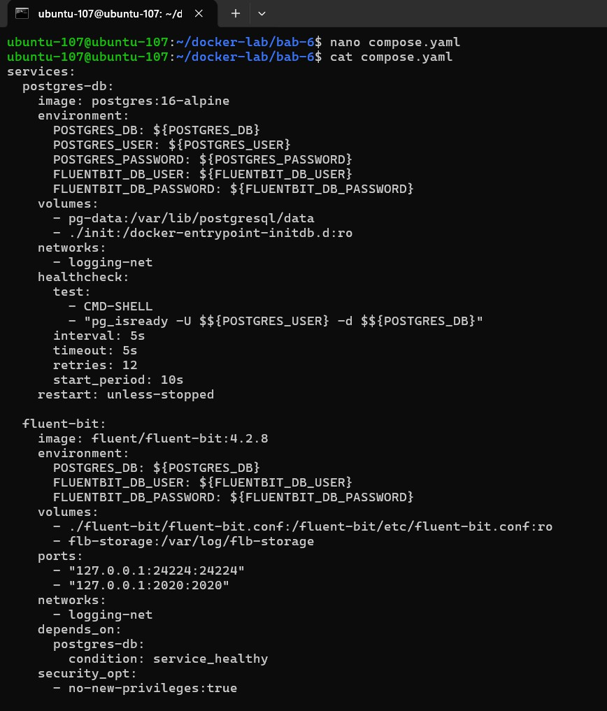

# 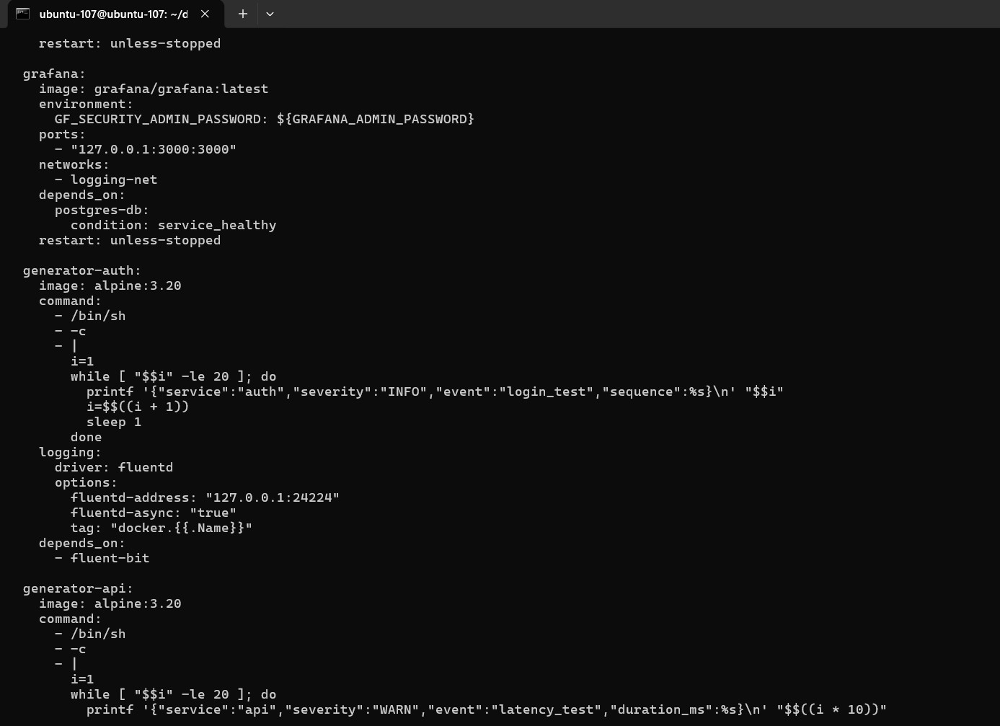3

**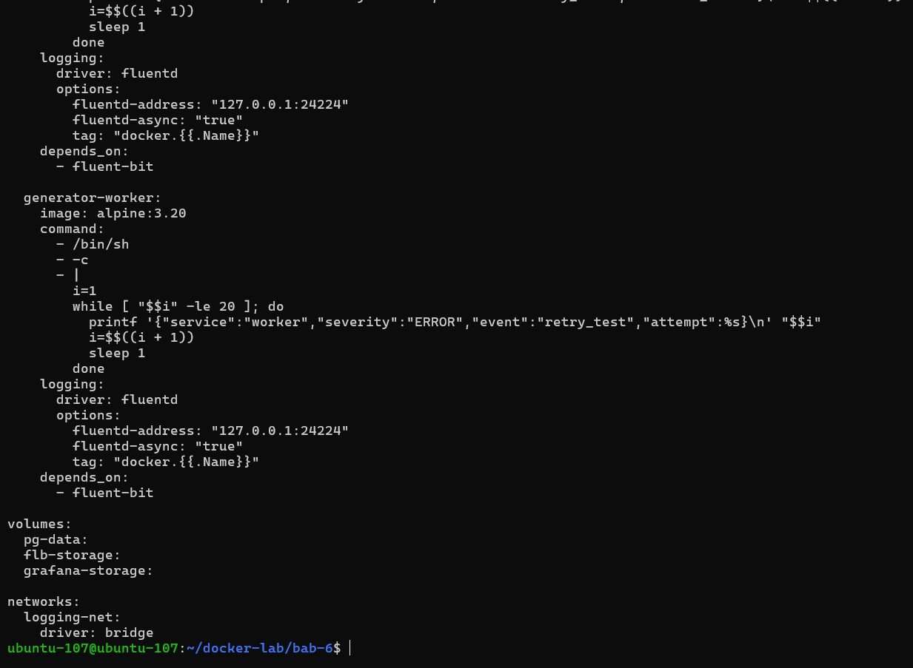**

# Konfigurasi Data Source PostgreSQL

Integrasi basis data dilakukan melalui menu _Data Sources_ di Grafana dengan menambahkan koneksi baru berlabel grafana-postgresql-datasource. Parameter utama diisi dengan mengarahkan _Host_ ke postgres-db:5432, nama basis data labdb, akun pengguna grafana\_reader, serta mengonfigurasi opsi SSL ke posisi _disable_. Pengujian koneksi berhasil divalidasi dengan munculnya pesan _Database Connection OK_. Selanjutnya, pengujian kueri SQL pada menu _Explore_ membuktikan bahwa Grafana mampu membaca log terstruktur dari tabel logs.fluentbit secara langsung.

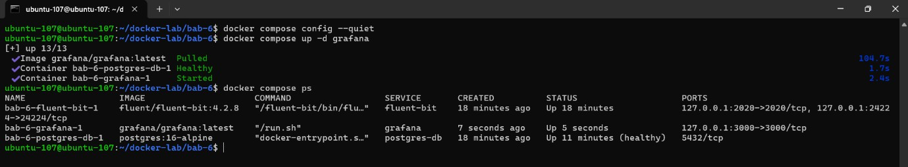

# Visualisasi dan Pembuatan Dashboard Log

Tahap akhir praktikum difokuskan pada penyusunan _dashboard_ visualisasi data log. Panel pertama dikonfigurasi dalam bentuk tampilan tabel (_Table View_) yang menyajikan rincian entri log secara terstruktur, mencakup stempel waktu (_timestamp_), tag generator container, dan pesan log format JSON. Selain itu, ditambahkan panel grafik tren (_time-series chart_) untuk memvisualisasikan volume dan sebaran kedatangan log dari berbagai service generator berdasarkan rentang waktu secara _real-time_.

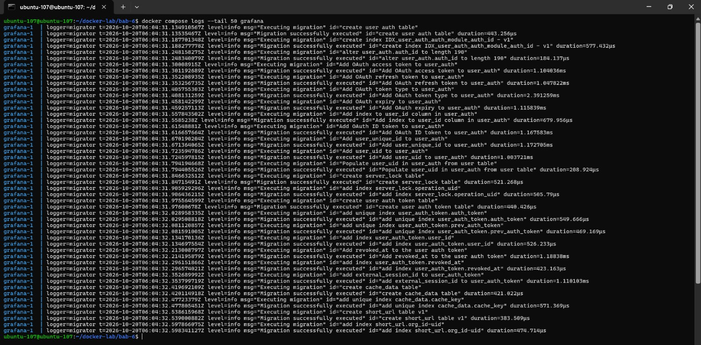

# ssh -L 3000:127.0.0.1:3000 [ubuntu-2@10.252.108.103](mailto:ubuntu-2@10.252.108.103)

[**http://localhost:3000**](http://localhost:3000/)

**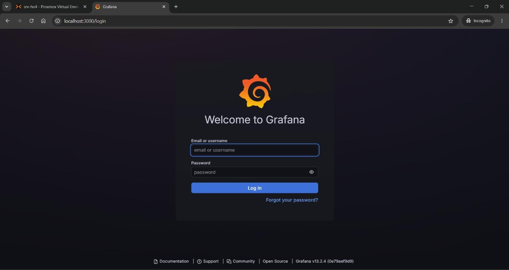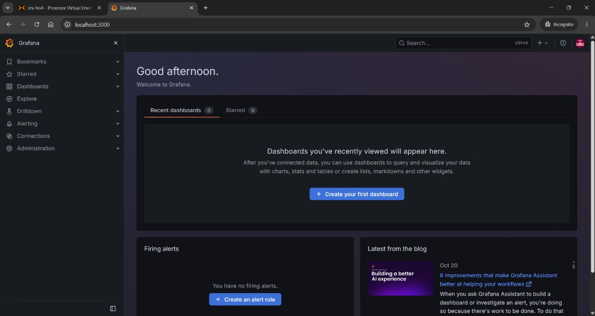**

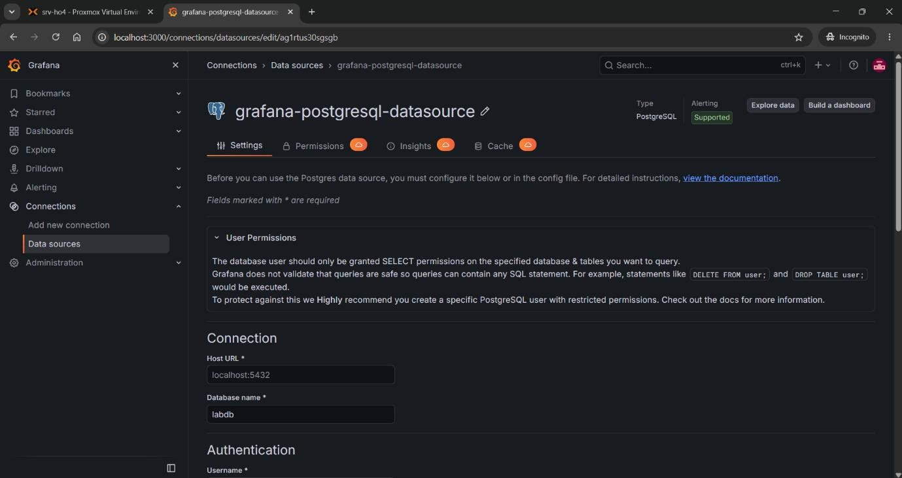

**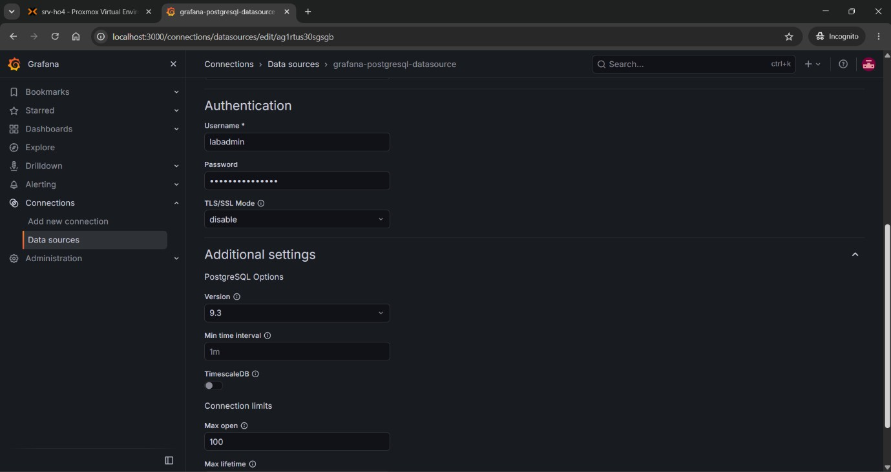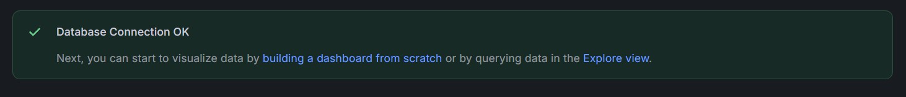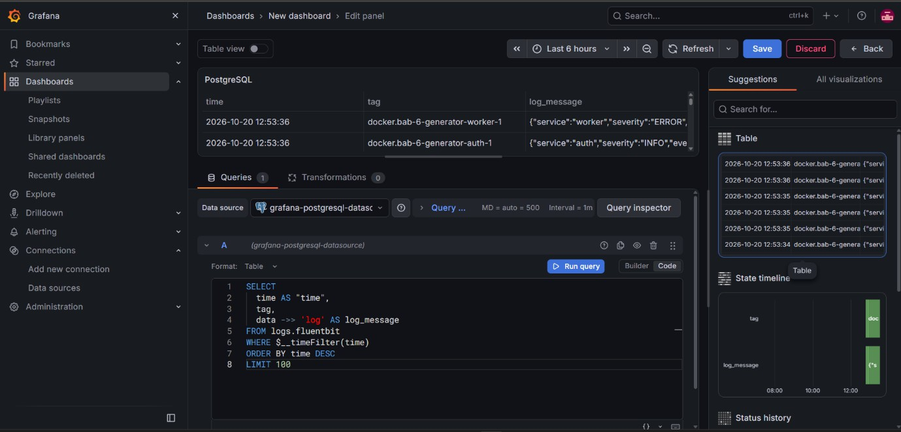**

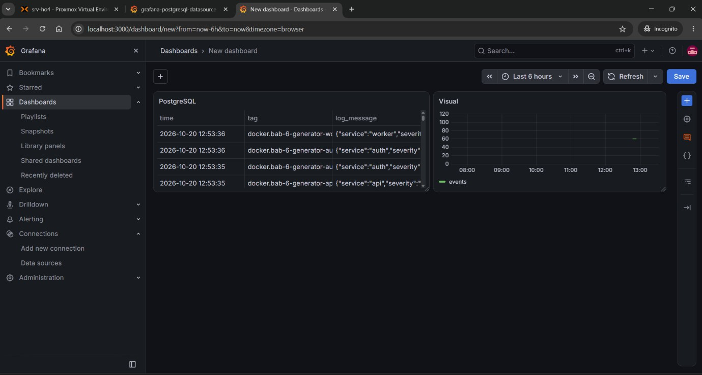
